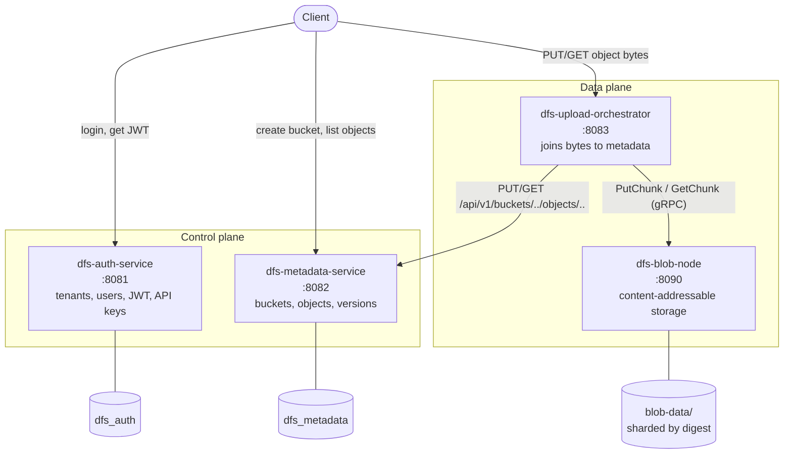
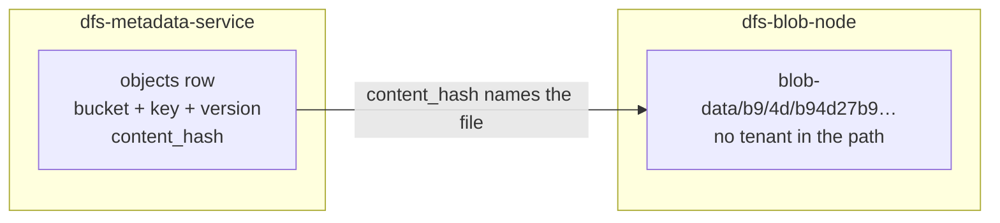
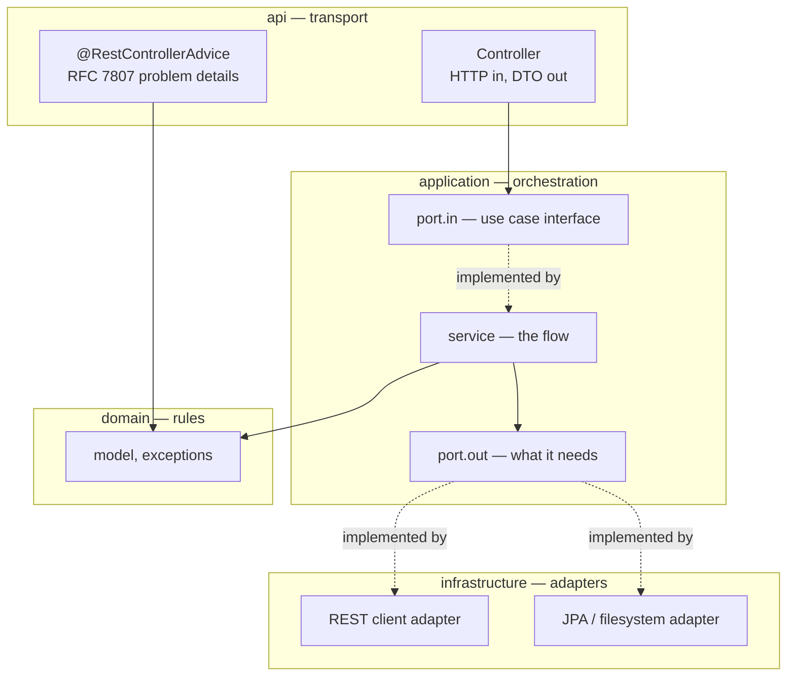

# Architecture

How the services fit together, and which parts of the shape are load-bearing.

Phase 1 covers four implemented services — auth, metadata, blob node, and the
upload orchestrator. The gateway, replication, GC, and admin modules exist as
scaffolds and are not part of any request path yet.

## Service map

The orchestrator is the only component that talks to both halves. Everything
else stays on one side of the line: the metadata service never sees bytes, and
the blob node never sees a tenant.

## Two contracts that cut across services

Both break quietly rather than loudly, which is why they are pinned in shared
code rather than re-implemented per service.

### Tenancy comes from the token

Every HTTP service is a JWT resource server. The tenant is read from the
validated token's `tenant_id` claim — never from a path, header, or body. A
service that accepted a tenant id from the request would let any caller address
any tenant's data, and nothing in a test suite would look wrong.

The shared pieces live in `dfs-common`:

| Piece | Role |
|---|---|
| `dfs.security.jwt` | Issuer and signing secret, one property block for issuer and validators alike |
| `DfsResourceServerConfiguration` | The single `JwtDecoder` bean, pinning HS256 and the expected issuer |
| `DfsJwtClaims` | Claim names — `tenant_id`, `email`, `role` — defined once |
| `DfsTokenClaims` | Reads tenant and user out of a validated `Jwt` |
| `DfsTestTokens` | Signs tokens in tests the way the auth service does, published as a test-jar |

A valid signature alone is not enough, so the decoder also pins the issuer: a
signature only proves something holding the secret minted the token, not that
our auth service did.

See [ADR 2](adr/0002-shared-token-contract.md).

### An object is two halves joined by a digest

Content and metadata live in different services and are linked only by a
SHA-256 hash.

- The blob node addresses content purely by digest. Identical bytes from two
  tenants are one blob, and it has **no DELETE endpoint** — a deduplicated blob
  has no single owner to authorize against, so reclamation needs refcounting and
  belongs to GC ([ADR 4](adr/0004-no-delete-on-blob-node.md)).
- The metadata service holds the pointer and is what enforces tenancy.
- `com.dfs.common.hash.Sha256` is the single definition of a digest, lowercase
  hex. Two services disagreeing on the encoding would file identical bytes under
  two names and deduplication would stop working silently.

See [ADR 3](adr/0003-content-addressable-storage.md).

## Layering inside a service

Each service uses the same hexagonal layout. Dependencies point inward:
`api` and `infrastructure` both depend on `application`, which depends on
`domain`. The domain layer imports no Spring, no JPA, and no transport type.

Concretely, in the orchestrator: `ObjectContentController` translates HTTP to
`ObjectTransferUseCase`; `ObjectTransferService` implements the flow and depends
on `BlobStorePort` and `MetadataRegistryPort`; `GrpcBlobStoreAdapter` and
`RestMetadataRegistryAdapter` implement those ports over their respective
transports. Phase 2 collected on this: moving the byte path from REST to gRPC
replaced one adapter and left the port, the service, and the controller
untouched. The cost is a layer of interfaces that would be unnecessary in a
system that never had to move.

See [ADR 1](adr/0001-clean-architecture.md).

## Persistence

| Service | Store | Schema owner |
|---|---|---|
| `dfs-auth-service` | PostgreSQL `dfs_auth` | Flyway |
| `dfs-metadata-service` | PostgreSQL `dfs_metadata` | Flyway |
| `dfs-admin-service` | PostgreSQL `dfs_admin` | Flyway |
| `dfs-blob-node` | Local filesystem | n/a |

One database per schema-owning service, created by
`deploy/postgres/init-databases.sql`. Each ships its own `V1__` migration and
its own default `flyway_schema_history`, so a shared database would mean the
second service to start fails validation on version 1 rather than applying its
own schema. `ddl-auto` stays `validate`: the schema is owned by migrations, not
inferred from entities.

The blob node stores files under a root sharded two levels deep by digest
prefix (`b9/4d/b94d27b9…`), which keeps directory sizes manageable as blob count
grows.

See [the ERD](erd.md) for the tables.

## Request flows

- [Upload sequence](upload-sequence.md) — blob first, metadata second
- [Download sequence](download-sequence.md) — metadata first, blob second

The asymmetry is deliberate and is the subject of
[ADR 6](adr/0006-blob-first-writes-metadata-first-reads.md).

## What Phase 1 deliberately does not do

- **gRPC on the byte path only.** Phase 2 moved the orchestrator's calls to the
  blob node onto gRPC; metadata stays REST, so the orchestrator uses the same
  public API as any other client, and the client-facing API stays REST
  ([ADR 10](adr/0010-grpc-for-the-byte-path.md)). The blob node still serves its
  REST endpoints, which retire once the gRPC path has proven itself.
- **Placement, not replication.** Phase 2 spreads chunks across a static set of
  blob nodes by rendezvous hashing, falls back to the next node when one does not
  answer, and records the node each chunk went to; reads follow the record
  ([ADR 11](adr/0011-chunk-placement-is-recorded-not-recomputed.md)). There is one
  copy of each chunk, so losing a node's disk loses data until replication lands
  in Phase 3.
- **No RBAC.** Auth stops at login, JWT, and API keys. A `role` claim exists
  (`OWNER` / `MEMBER`) but no per-bucket permission is enforced.
- **No chunking.** Each upload is buffered whole in memory, bounded by
  `dfs.upload.max-object-size`. That buffer is what allows the digest to be
  computed before the first byte is sent downstream; Phase 2's chunked path
  removes the constraint and the guarantee that comes with it.
- **No refcounting or GC.** Blobs are never reclaimed, so a failed metadata write
  leaves bytes on disk until Phase 3.
