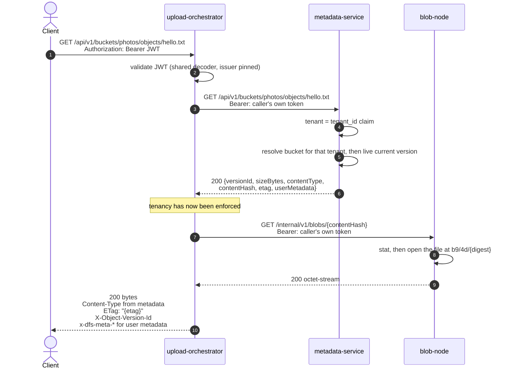
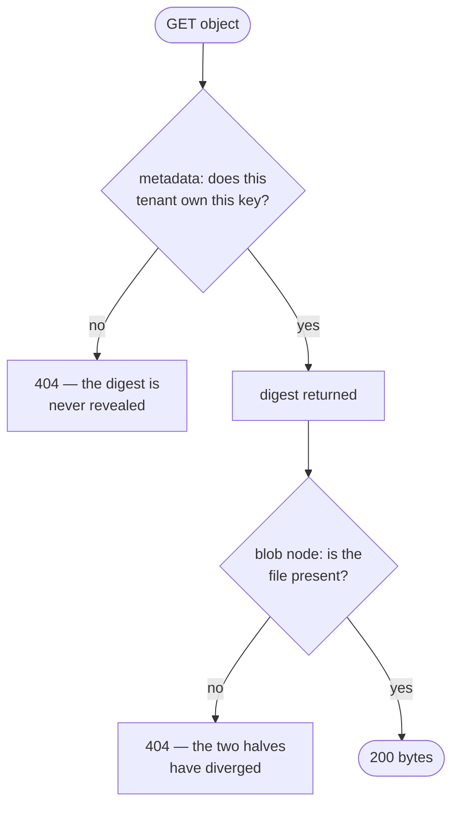

# Download sequence

`GET /api/v1/buckets/{bucket}/objects/{key}` against the upload orchestrator
(`:8083`). The reverse of the write path, and deliberately the reverse order:
metadata first, blob second.

## The happy path



Response headers observed from a real run:

```
HTTP/1.1 200
ETag: "b94d27b9934d3e08a52e52d7da7dabfac484efe37a5380ee9088f7ace2efcde9"
X-Object-Version-Id: d4ecb674-2174-4890-a8d5-a0a07138d360
Content-Type: text/plain
Content-Length: 11
```

## Why metadata first

The metadata service is what enforces tenancy. A digest has no owner — the blob
node cannot make that check, and by design does not try, because the same bytes
may legitimately belong to many tenants at once.

Consulting the blob node first would therefore serve any blob whose digest a
caller could guess or had once seen, with no tenant check anywhere in the path.
Ordering the reads this way is the whole protection:



Because the check happens before the digest is ever produced, a tenant asking
for another tenant's key gets a 404 with no indication that the content exists
at all — even when that content is byte-identical to something they uploaded
themselves and shares a single file on disk.

See [ADR 6](adr/0006-blob-first-writes-metadata-first-reads.md).

## When the halves diverge

Metadata pointing at a digest the blob node does not have is the one failure the
write ordering is designed to prevent, but it is still possible — a blob node
losing its disk, or a restore from an inconsistent backup.

The orchestrator treats it as distinct from a plain miss. A 404 from the blob
node at this point is not the caller asking for something that never existed; it
means the object is unreadable and the system is inconsistent:

> Metadata references blob `{digest}` but the blob node does not have it

That surfaces to the client as a 404, and to the operator as a log line naming
the digest. Nothing repairs it automatically — detection and repair are Phase 3
work alongside GC and refcounting.

## HEAD and conditional GET

Both work, and both save the same thing: bytes on the client leg, not work
downstream.

`HEAD` is routed by Spring to the `GET` handler and answered with the same
headers and no body, reporting size, content type, ETag, and version id.

Conditional GET works without any explicit handling in the controller — Spring
compares `If-None-Match` against the `ETag` on the `ResponseEntity` and returns
304 with an empty body:

```bash
curl -i localhost:8083/api/v1/buckets/photos/objects/hello.txt \
  -H "Authorization: Bearer $TOKEN" \
  -H 'If-None-Match: "b94d27b9…cde9"'
# → 304, no body
```

Since the object's ETag *is* its content digest, this is exact rather than
heuristic: a matching ETag means the bytes are identical, not merely that the
resource looks unchanged.

The saving is only on the wire, though. The controller method has already run by
the time Spring evaluates the precondition, so a 304 — like a `HEAD` — still
costs a metadata lookup and a full blob fetch. Making either cheap would mean
short-circuiting before the blob read, which Phase 1 does not do.

Note for anyone testing this: MockMvc retains the body on `HEAD`, so a real
server's empty `HEAD` response cannot be asserted in a MockMvc test.

## Failure responses

| Condition | Status | Notes |
|---|---|---|
| No or invalid token | 401 | Enforced before the controller |
| Key not found, or owned by another tenant | 404 | Indistinguishable by design |
| Bucket not found | 404 | Same shape as a missing key |
| Metadata references a missing blob | 404 | Logged with the digest; the halves have diverged |
| Downstream 401 / 403 | 401 / 403 | Passed through |
| Other downstream error status | 502 | `DownstreamServiceException` |
| Metadata or blob node unreachable | 504 | `ResourceAccessException` |

## What Phase 1 does not do

- **No range requests.** `Range` is ignored — the whole object is returned with
  200, and no `Accept-Ranges` header is advertised.
- **No streaming.** The orchestrator holds the entire object in memory on the way
  out, the same constraint as the write path. Phase 2's chunked path removes it.
- **No version selection.** The current version is served; the metadata service
  exposes version history at `/api/v1/buckets/{bucket}/object-versions/{key}`,
  but the content path has no way to ask for one.
