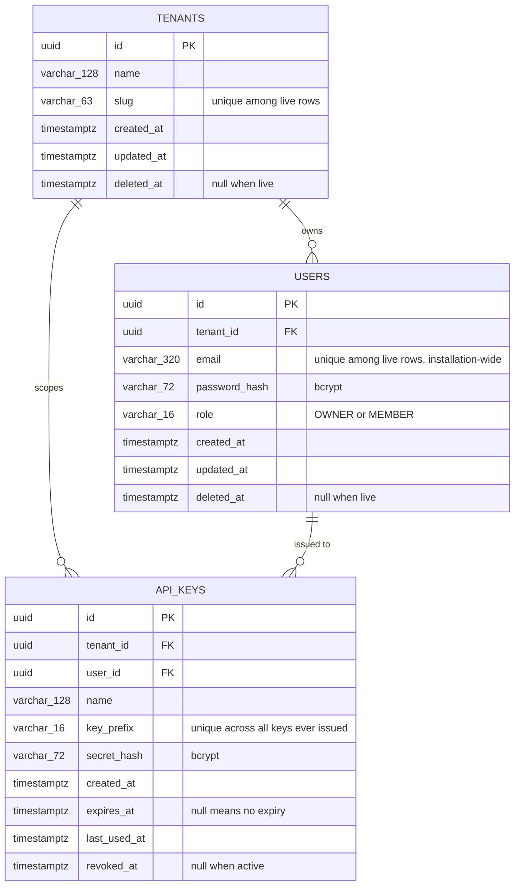
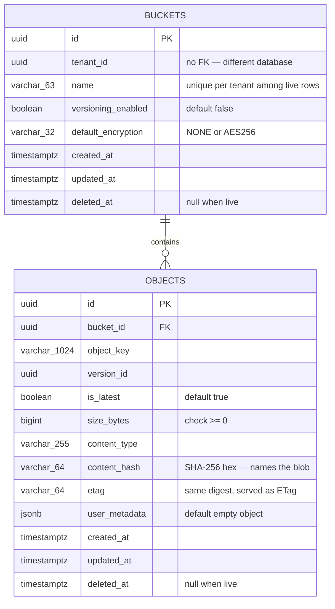
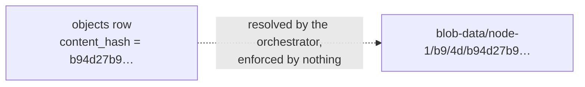

# Data model

Generated from the Flyway migrations, which own the schema — `ddl-auto` stays
`validate`, so entities never create or alter a table.

| Source | Database |
|---|---|
| `dfs-auth-service/src/main/resources/db/migration/V1__create_tenants_users_and_api_keys.sql` | `dfs_auth` |
| `dfs-metadata-service/src/main/resources/db/migration/V1__create_bucket_and_object_metadata.sql` | `dfs_metadata` |

The two live in **separate databases**, so no foreign key crosses between them.
That is the point — see [architecture](architecture.md#persistence).

## Auth — `dfs_auth`

## Metadata — `dfs_metadata`

## The join that is not a foreign key

`objects.content_hash` is the link to the bytes, and it is not — and cannot be —
a foreign key. The content lives on a blob node's filesystem, not in Postgres.

Two consequences follow, and both are deliberate:

- **The relationship is many-to-one.** Any number of `objects` rows, across any
  number of tenants, may carry the same `content_hash`. That is deduplication,
  and it is why the blob node has no DELETE — no single row owns the file.
- **Nothing enforces referential integrity.** A row can point at a digest the
  blob node does not have. The write ordering makes that unlikely rather than
  impossible, and detection belongs to Phase 3 alongside refcounting.

`tenant_id` on `buckets` is the same kind of link: a real reference to
`dfs_auth.tenants.id` that no constraint can express, because the tenant lives in
another service's database. It is populated only from the validated token's
`tenant_id` claim, never from the request.

## Soft deletes

Every table except `api_keys` uses `deleted_at IS NULL` to mean live; `api_keys`
uses `revoked_at IS NULL`. Uniqueness is enforced with partial indexes over the
live rows only:

| Index | Table | Guarantees |
|---|---|---|
| `ux_tenants_slug_live` | `tenants` | One live tenant per slug |
| `ux_users_email_live` | `users` | One live user per email, installation-wide |
| `ux_api_keys_prefix` | `api_keys` | Prefix unique across all keys, including revoked |
| `ux_buckets_tenant_name_live` | `buckets` | One live bucket per name per tenant |
| `ux_objects_bucket_key_version` | `objects` | A version id appears once per key |
| `ux_objects_current_version` | `objects` | At most one live current version per key |

Two of these carry weight worth spelling out:

- **`ux_users_email_live`** is installation-wide, not per tenant, because login
  takes an email and no tenant hint. The address has to identify exactly one live
  account for the credential check to be unambiguous. The cost is that one person
  cannot hold accounts in two tenants under the same address.
- **`ux_objects_current_version`** holds for versioned and non-versioned buckets
  alike, so "the current version" is a database invariant rather than something
  application code maintains. Two concurrent writes to a key cannot both end up
  marked `is_latest`; the loser fails on the constraint and surfaces as a 409.

Names are reusable only after the previous row is purged, not merely soft
deleted — a soft-deleted bucket still occupies its name for that tenant.

## Supporting indexes

| Index | Table | Serves |
|---|---|---|
| `ix_users_tenant_live` | `users` | Listing a tenant's users |
| `ix_api_keys_tenant_active` | `api_keys` | Listing a tenant's active keys |
| `ix_objects_bucket_key_live` | `objects` | Prefix listing and version history |
| `ix_buckets_tenant_live` | `buckets` | Listing a tenant's buckets |

`ix_buckets_tenant_live` is defined on `(tenant_id, name)` with the same
`WHERE deleted_at IS NULL` predicate as `ux_buckets_tenant_name_live`, so it
duplicates the unique index exactly and earns nothing beyond a second structure
to maintain on every write. Worth dropping in a later migration.

## Not here yet

Chunks, replicas, multipart upload sessions, and blob refcounts all belong to
later phases. `versioning_enabled` and `default_encryption` are stored and
returned but nothing reads them to change behaviour yet.
