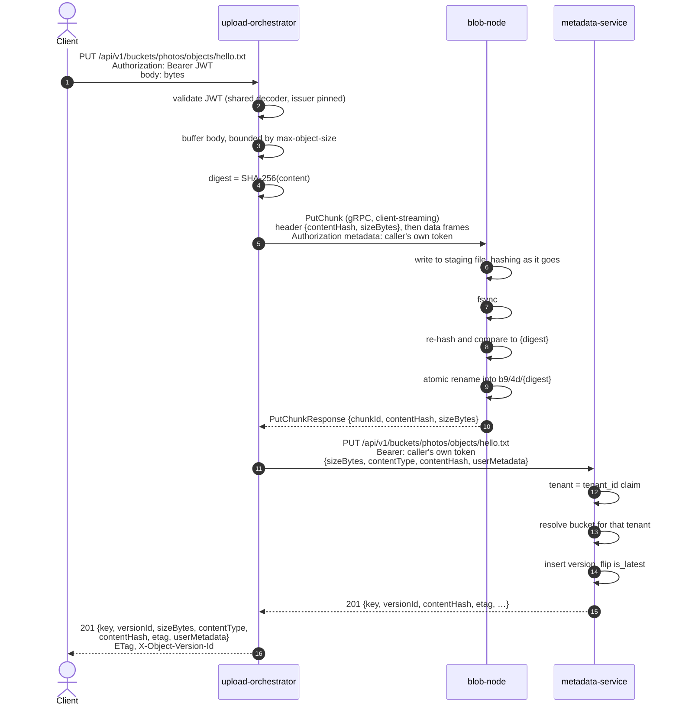
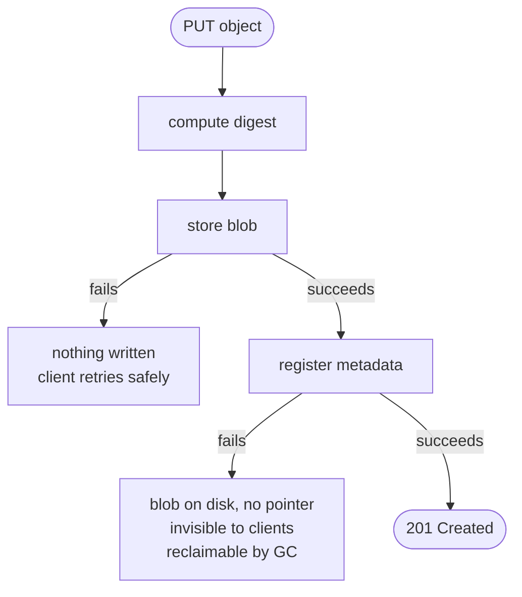
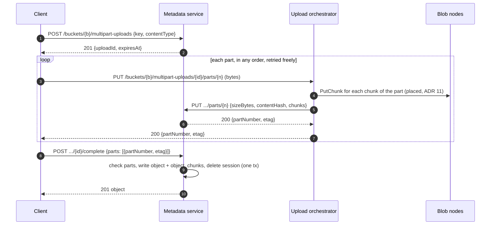

# Upload sequence

`PUT /api/v1/buckets/{bucket}/objects/{key}` against the upload orchestrator
(`:8083`). The orchestrator stores the bytes first and registers the pointer
second.

## The happy path



The response body observed from a real run:

```json
{
  "key": "hello.txt",
  "versionId": "d4ecb674-2174-4890-a8d5-a0a07138d360",
  "sizeBytes": 11,
  "contentType": "text/plain",
  "contentHash": "b94d27b9934d3e08a52e52d7da7dabfac484efe37a5380ee9088f7ace2efcde9",
  "etag": "b94d27b9934d3e08a52e52d7da7dabfac484efe37a5380ee9088f7ace2efcde9",
  "userMetadata": {}
}
```

## Why blob first

Nothing spans both services transactionally, so the only real choice is which
inconsistency a partial failure leaves behind.

| Order | A partial failure leaves | Detectable by |
|---|---|---|
| Metadata first | An object that lists but cannot be downloaded | Only a repair job |
| **Blob first** | Bytes nothing refers to | GC, once refcounting exists |

Unreferenced bytes are the cheaper failure, so that is the one the system
accepts. The cost is real but bounded: orphaned blobs occupy disk until Phase 3
reclaims them, and today nothing reclaims them at all.

Content addressing keeps retries from compounding the problem. A retry of the
same upload computes the same digest and lands on the same blob rather than
accumulating a fresh orphan per attempt.



See [ADR 6](adr/0006-blob-first-writes-metadata-first-reads.md).

## Idempotency and deduplication

The digest names the content, so a write is idempotent by construction. Sending
the same bytes twice is indistinguishable from sending them once, which is what
makes retries safe without a transaction log.

Two mechanisms, at two layers:

- The blob node checks for an existing file before staging anything. Same name
  means same bytes, so the write is already done and it returns the existing
  record.
- If two concurrent writers race past that check, both stage and both attempt the
  rename. The loser catches `FileAlreadyExistsException` and discards its staging
  file — the winner's bytes are identical by definition, so this is success, not
  a conflict.

Deduplication follows from the same property and spans tenants. Uploading
identical bytes under two keys, or under two different tenants, produces one file
on disk and the same `contentHash` in every response. Tenancy is unaffected: the
pointer rows stay separate, so a tenant asking for another tenant's key gets a
404 even though the bytes underneath are shared.

## Integrity on write

The blob node never trusts the digest in the URL. It streams the body to a
staging file while hashing, forces the file to disk, then compares:

- **Mismatch** → `BlobDigestMismatchException`, staging file discarded, nothing
  published. Corruption in transit cannot be filed under a name that does not
  describe it.
- **Match** → atomic rename into place.

Staging plus rename means a blob is either absent or whole. Streaming straight
to the final path would make a partially written blob readable, and a reader
cannot tell a truncated file from a complete one — the digest is the file's
name, not something re-checked on every read.

The `fsync` before the rename is the difference between "the OS has the bytes"
and "the disk has the bytes". Without it, power loss after a 201 could leave
metadata pointing at content that no longer exists — a dangling object, which is
the worst outcome available, because nothing detects it until a read fails.

## The token

The orchestrator holds no service account. It forwards the caller's own JWT to
both downstream services, taken from the validated `Jwt` object rather than
re-read from the `Authorization` header, so what is forwarded is exactly what
was verified.

A service account would replace the caller's tenant claim with its own
downstream, and the metadata service could no longer tell one tenant's writes
from another's. The cost is that the downstream call inherits the caller's token
lifetime — a long upload with a short-lived token can fail at the metadata step
having already written the blob, which lands in the orphaned-bytes case above.

See [ADR 7](adr/0007-forward-the-callers-token.md).

## Multipart upload

For an object too large to send safely in one request, a client opens a session
with the metadata service, sends each part's bytes through the orchestrator, and
completes the session once every part is in ([ADR 12](adr/0012-s3-style-multipart-upload.md)).
Only the parts carry bytes, so only the parts go through the orchestrator.



- **Each part is one request,** chunked and placed exactly like a single upload,
  and held to the same `max-object-size` ceiling. The finished object may be
  larger than that; that is the point.
- **Blob-first still holds per part.** The chunks are written before the session
  hears of them, so a part sent to a session that is not open — completed,
  aborted, expired, or another tenant's — leaves unreferenced bytes and a 404.
- **Re-uploading a part number replaces it.** Completion names each part by the
  etag its upload returned, so a part replaced after the client last looked is
  refused rather than silently used.
- **Completion follows S3's rules:** at least one part, ascending part numbers
  (gaps allowed), every part but the last at least 5 MiB. The object's chunk list
  is the parts' lists end to end, so its `contentHash` is the composite of every
  chunk in order — and the client's choice of part sizes is part of the object's
  identity.
- **The session is tenant-scoped.** An upload id reaches nothing without a token
  for the tenant that opened it.
- **Abandoned sessions expire** after `dfs.metadata.multipart.session-ttl` (24h).
  They are refused from that moment, and a sweep deletes them in batches, turning
  their staged chunks into ordinary orphans for GC.

## Failure responses

All errors are RFC 7807 problem details.

| Condition | Status | Notes |
|---|---|---|
| No or invalid token | 401 | Enforced before the controller |
| Bucket does not exist | 404 | Metadata's 404 is translated; the blob may already be written |
| Body exceeds `max-object-size` | 413 | Detected while buffering, before any downstream call |
| Digest mismatch at the blob node | 502 | Blob node answers `INVALID_ARGUMENT`; the orchestrator reports it as a downstream failure, since the caller did nothing wrong |
| Downstream rejects the token | 401 / 403 | Passed through — HTTP 401/403 from metadata, `UNAUTHENTICATED`/`PERMISSION_DENIED` from the blob node |
| Other downstream error status | 502 | `DownstreamServiceException` |
| A chunk's preferred blob node unreachable | — | Not a failure: the chunk is written to the next node in its rendezvous ranking and recorded there ([ADR 11](adr/0011-chunk-placement-is-recorded-not-recomputed.md)). Only `UNAVAILABLE`/`DEADLINE_EXCEEDED` fall through; a node that answers and refuses fails the upload |
| Every blob node unreachable, or metadata unreachable | 504 | `ResourceAccessException` for REST, `UNAVAILABLE`/`DEADLINE_EXCEEDED` for gRPC — both become `DownstreamUnavailableException` |

The bucket-does-not-exist case is worth noting: because the blob write happens
first, a 404 from metadata means the bytes are already on disk with nothing
pointing at them. That is by design, not an oversight.
